<h1 align="center">Rodrigo Caetano</h1>

  <strong>Engenheiro de Software | Especialista WordPress & WooCommerce | Especializando em IA e Prompt Engineering</strong>

  
  
  
  
  

---

## 🧑‍💻 Sobre Mim

Engenheiro de Software formado pela **UNOPAR (2024)**, com **mais de 25 anos de experiência prática** em desenvolvimento de sistemas, em **transição avançada para Inteligência Artificial Generativa** — com foco em Prompt Engineering, automações e soluções de GenAI aplicadas em produtos reais.

**Destaque atual:** idealizador e desenvolvedor da **DigitalDreams FM** (2026), plataforma de rádio web e app Android com **mais de 5.000 músicas geradas por IA** — responsável por toda a arquitetura, integração de modelos de IA, prompt engineering e desenvolvimento completo da solução. Além da plataforma, gera conteúdo com IA para redes sociais: **+18 mil seguidores no Instagram** com imagens e músicas criadas por inteligência artificial.

**Experiência web:** fundador e principal desenvolvedor da **ViaWeb** desde 2009, com **mais de 60 projetos entregues** em WordPress, WooCommerce e soluções customizadas. Especialista em customizações PHP, Elementor, ACF, SEO (Rank Math) e otimização de performance.

**Desenvolvimento com IA:** trabalho com agentes de IA (**Hermes Agent**), integração de modelos de linguagem (LLMs/GenAI), automações com IA e infraestrutura própria em **VPS** (Docker, Nginx, PM2, MySQL) — do deploy à manutenção de aplicações de IA em produção.

Pós-graduado em **Gerenciamento de Projetos de TI (MBA)**, com gestão empresarial de 1998 a 2024 em empresas familiares (Caetano Bilhar & La Bella Festa).

Busco oportunidades **remotas ou híbridas** como **Engenheiro de IA/GenAI**, AI Engineer ou Gerente de Projetos de TI.

📍 Maringá, Paraná, Brasil

---

## 🛠️ Tecnologias & Ferramentas

---

## 🎓 Formação Acadêmica

| Instituição | Curso | Período |
|---|---|---|
| **UNOPAR** | Bacharelado em Engenharia de Software | 2021 - 2024 |
| **FAVENI** | Pós-Graduação MBA em Gerenciamento de Projetos de TI | 2022 - 2024 |
| **UNOPAR** | Tecnólogo em Processos Gerenciais | 2008 - 2010 |
| **FEMA - Assis** | Processamento de Dados / TI | 1998 - 1999 |

---

## 📜 Certificações

- 🤖 **Engenharia de Prompts na AWS com Claude** (DIO, 2024)
- 📊 **Formação Engenharia de Dados: Domine Big Data!** (Udemy, 2025)
- 🧪 **Formação Cientista de Dados** (Udemy, 2025)
- 🧠 **Curso de Inteligência Artificial - Google Cloud** (2024)
- 🐍 **Python 3: Do Básico ao Avançado** (Udemy, 2024)
- 🏅 **Formação Scrum Master Specialist**
- ⚙️ **DevOps - Gestão de Infraestrutura de TI**
- 🔗 **Desvendando a Blockchain**

---

## 🌐 Idiomas

| Idioma | Nível |
|---|---|
| 🇧🇷 Português | Nativo |
| 🇺🇸 Inglês | Intermediário Avançado |
| 🇪🇸 Espanhol | Básico |

---

## 🏆 Projetos em Destaque

| Projeto | Destaque |
|---|---|
| 🎵 [**DigitalDreams FM**](http://www.digitaldreamsfm.com/) | Rádio web e app Android com 5.000+ músicas geradas por IA. [Google Play](https://play.google.com/store/apps/details?id=com.digitaldreamsfm.player) |
| 🤖 [**AI Music Prompt Studio**](https://ai-music.viaweb.pro) | SaaS que transforma ideias musicais em prompts técnicos prontos para Suno, Udio, Music Flow e Mureka |
| 🖨️ [**Elite Printers**](https://www.eliteprinters.com.br/) | E-commerce WooCommerce para venda e manutenção de impressoras |

---

## 📂 Portfólio de Sites

Clique na imagem para visitar o site. Para cada projeto: **stack utilizada, recursos implementados e como funciona**:

### 🤖 Aplicações Web & IA

| Screenshot | Projeto & Detalhes Técnicos |
|:---:|:---|
|  | **[DigitalDreams FM](http://www.digitaldreamsfm.com/)** *Stack: WordPress · Elementor · Next.js · Android (Java) · IA Generativa* Plataforma completa de rádio web com música **100% gerada por IA** — site institucional, web player e app Android publicado no Google Play. • 5.000+ músicas geradas por IA • Streaming 24/7 sem anúncios • Votação de faixas, comentários em tempo real e perfis de ouvintes • App Android nativo (Java) no [Google Play](https://play.google.com/store/apps/details?id=com.digitaldreamsfm.player) • Conteúdo com IA: +18 mil seguidores no Instagram |
| [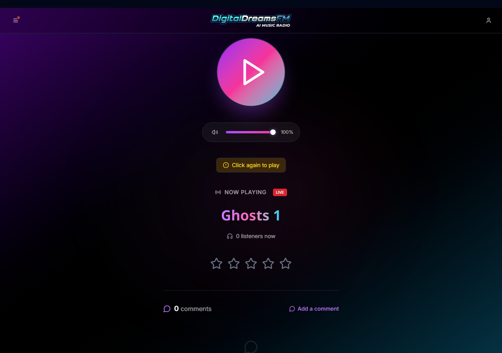](https://player.digitaldreamsfm.com) | **[DigitalDreams FM Player](https://player.digitaldreamsfm.com)** *Stack: Next.js · TypeScript · Streaming* Web player da rádio, integrado ao site e ao app Android. • Streaming contínuo 24/7 com tela "now playing" ao vivo • Contador de ouvintes em tempo real • Avaliação por estrelas e comentários por faixa • Interface dark responsiva |
| [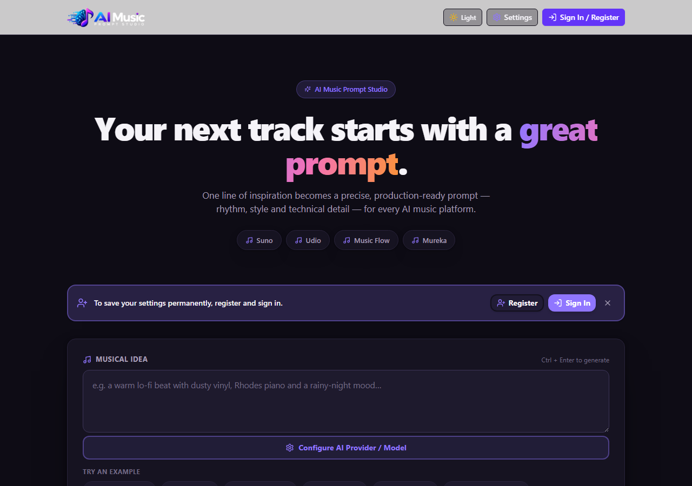](https://ai-music.viaweb.pro) | **[AI Music Prompt Studio](https://ai-music.viaweb.pro)** *Stack: Next.js 16 · TypeScript · Tailwind v4 · NextAuth (Google OAuth) · Resend · Prisma (SQLite) · 25+ APIs de IA* **Como funciona:** o usuário descreve uma ideia musical em linguagem natural e a aplicação a estrutura em 3 camadas — **Ritmo** (BPM, compasso, percussão), **Estilo** (gênero, era, vocais) e **Detalhes Técnicos** (instrumentação, mixagem) — gerando prompts prontos para Suno, Udio, Music Flow, Mureka e outras plataformas. • Login com **Google (OAuth)** ou cadastro com **e-mail de confirmação via Resend** • Motor multi-provedor: 25+ APIs de IA (Gemini, Groq, OpenRouter, OpenAI, DeepSeek, Grok, Mistral, Ollama local...) com descoberta dinâmica de modelos • Sincronização permanente de preferências em SQLite criptografada (Prisma) • Design system próprio (Aurora): temas light/dark com WCAG AA • Deploy automatizado: GitHub Actions → VPS (PM2/Nginx) |
| [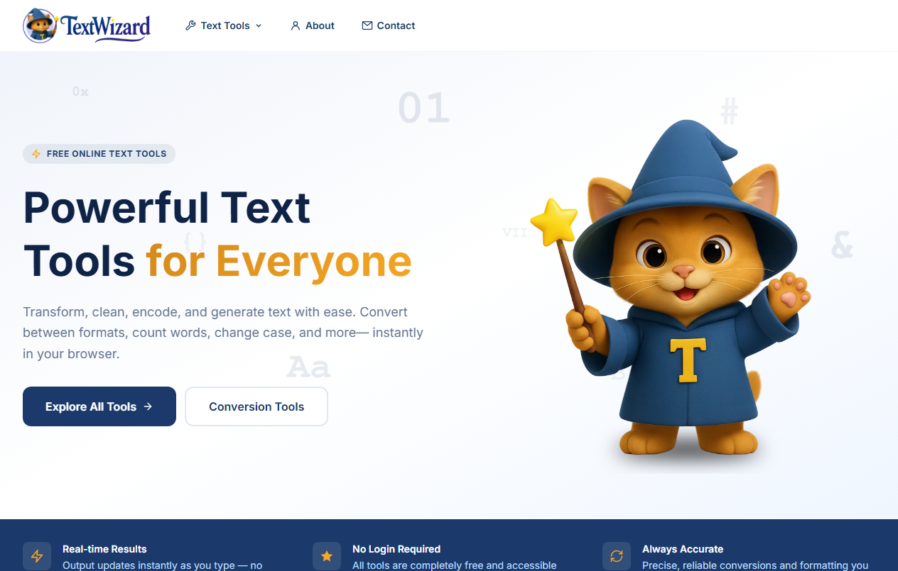](https://www.textwizard.tools) | **[TextWizard](https://www.textwizard.tools)** *Stack: Next.js · TypeScript* Suite de ferramentas de texto gratuitas, **100% no navegador, sem login**. • Conversão e encoding/decoding (Base64 etc.) • Formatação, limpeza e geração de texto • Contagem de palavras e mudança de caixa • Resultados em tempo real — os dados não saem do navegador |

### 🛒 E-commerces (WooCommerce)

| Screenshot | Projeto & Detalhes Técnicos |
|:---:|:---|
|  | **[Dafnée Beauty](https://www.dafneebeauty.com)** *Stack: WordPress · WooCommerce · Elementor · Mercado Pago · Google Listings & Ads · AIOSEO* E-commerce de cosméticos e beleza. • Checkout com parcelamento em até 12x (**Mercado Pago**) • Simulador de frete + frete grátis para Maringá • **Google Listings & Ads** (Shopping) integrado • Programa de afiliados (YITH) • Atendimento via WhatsApp e SEO (AIOSEO) |
| [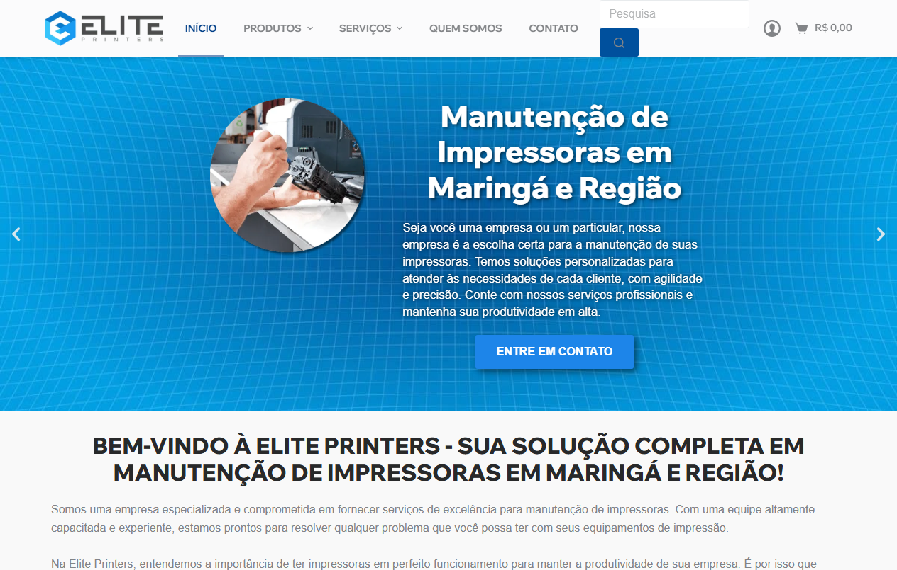](https://www.eliteprinters.com.br/) | **[Elite Printers](https://www.eliteprinters.com.br/)** *Stack: WordPress · WooCommerce · Blocksy · LiteSpeed Cache* E-commerce + serviços para o mercado de impressão em Maringá. • Venda de impressoras usadas e revisadas, peças e suprimentos • Serviços de manutenção com solicitação online • Performance otimizada (LiteSpeed Cache) |
| [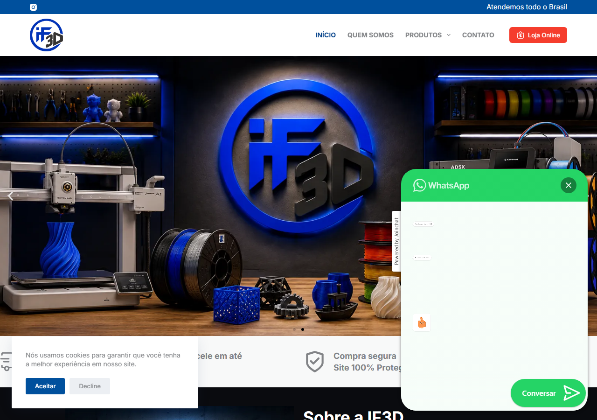](https://www.if3d.com.br) | **[IF3D](https://www.if3d.com.br)** *Stack: WordPress · WooCommerce · Elementor · Blocksy Pro* E-commerce de filamentos para impressão 3D e impressoras. • Catálogo de filamentos PLA, PETG, ABS, TPU + impressoras Bambu Lab e Flashforge • Parcelamento em 12x e envio para todo o Brasil • Migração completa de infraestrutura de hospedagem |
|  | **[Gráfica Moreno](https://www.graficamoreno.com.br)** *Stack: WordPress · WooCommerce · Elementor Pro · Smush* Site institucional + catálogo de embalagens e materiais gráficos. • Caixas personalizadas, tags para roupas, triedos, folhetos e envelopes • Orçamento direto via WhatsApp • SEO com Google Site Kit |

### 🏥 Saúde & Bem-estar

| Screenshot | Projeto & Detalhes Técnicos |
|:---:|:---|
| [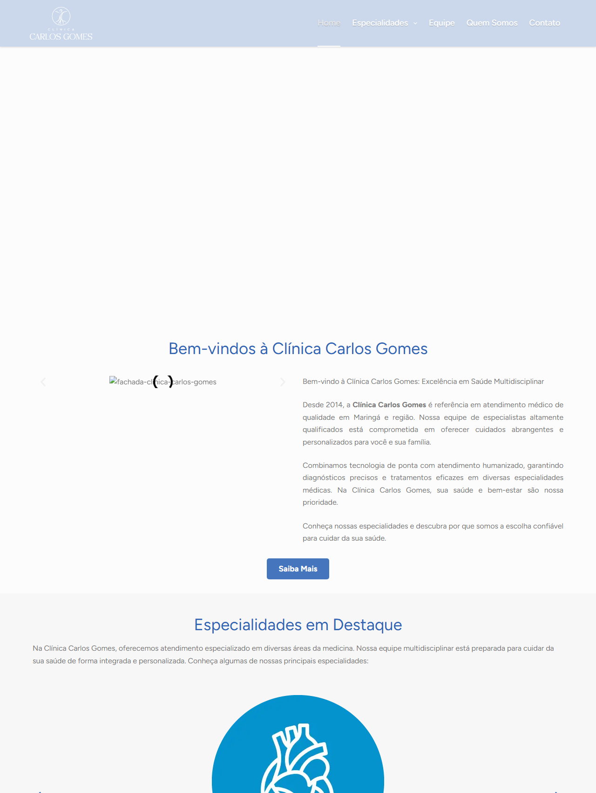](https://www.clinicacarlosgomes.med.br) | **[Clínica Carlos Gomes](https://www.clinicacarlosgomes.med.br)** *Stack: WordPress · Blocksy Pro · Depicter · LiteSpeed Cache* Site institucional de clínica multidisciplinar em Maringá. • Especialidades, corpo clínico e convênios • Sliders e galerias (Depicter) • SEO local e performance (LiteSpeed Cache) |
|  | **[Podóloga Cláudia Caetano](https://www.podologamaringa.com.br/)** *Stack: WordPress · Blocksy · Essential Addons · LiteSpeed Cache* Site profissional de podologia em Maringá. • Serviços e tratamentos podológicos • Agendamento direto via WhatsApp • SEO local |
|  | **[Podóloga Elaine Amaral](https://www.maringapodologia.com.br/)** *Stack: WordPress · Elementor · Blocksy Pro* Site profissional com catálogo de tratamentos podológicos. • Fotobiomodulação, onicocriptose, pés diabéticos, verruga plantar • Atendimento home care • Agendamento via WhatsApp |
| [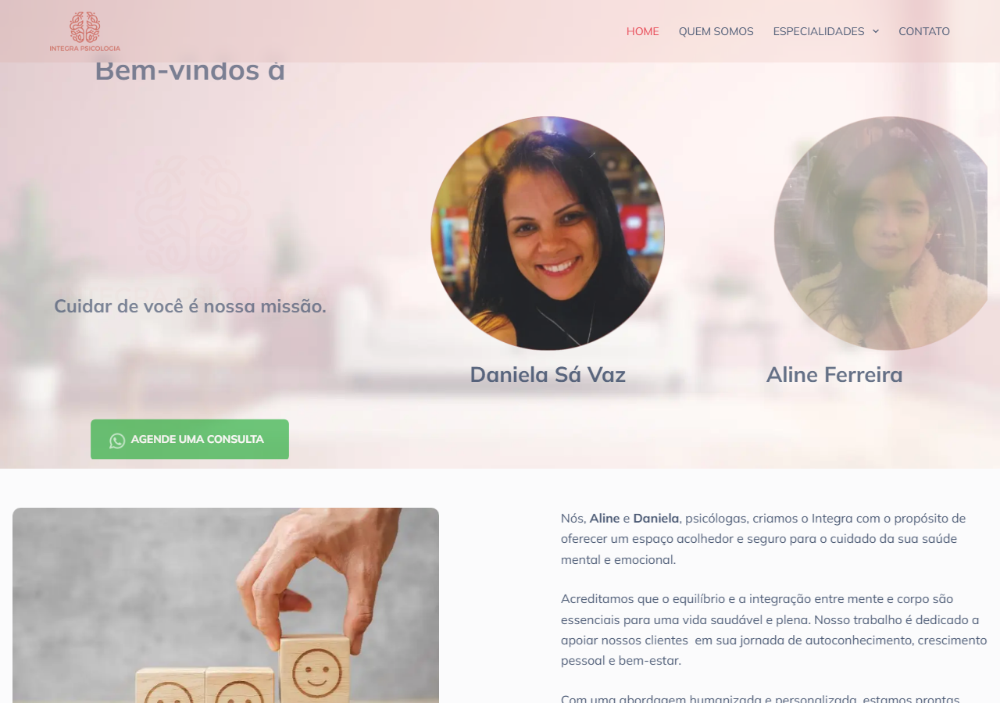](https://www.integrapsicologia.com.br) | **[Integra Psicologia](https://www.integrapsicologia.com.br)** *Stack: WordPress · Elementor · Blocksy Pro · Depicter* Consultório de psicologia com atendimento online e presencial. • Psicoterapia individual, de casal/familiar e grupos terapêuticos • Avaliação psicológica • Agendamento de consultas |

### 🏢 Institucionais & Serviços

| Screenshot | Projeto & Detalhes Técnicos |
|:---:|:---|
| [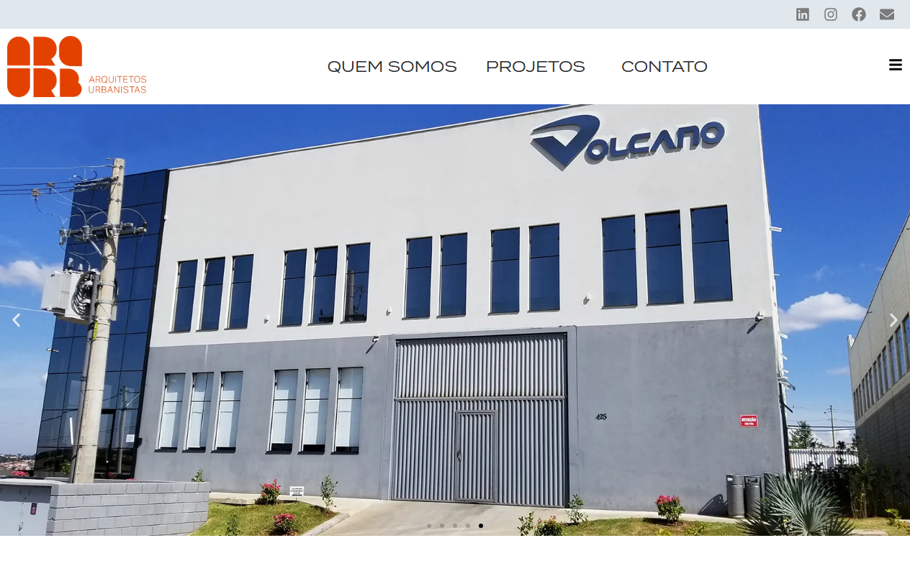](https://www.arq-urb.com/) | **[Arquitetos Urbanistas](https://www.arq-urb.com/)** *Stack: WordPress* Escritório de arquitetura e urbanismo com atuação nacional. • Portfólio de projetos em carrossel • Apresentação da equipe e contato |
|  | **[Black Bridge Business](https://blackbridgebusiness.com)** *Stack: WordPress · Elementor Pro · WPML · Sticky Header* Consultoria em exportação e importação de commodities. • Site multilíngue em **5 idiomas (português, inglês, espanhol, alemão e holandês)** via WPML • Seletor de idiomas e header fixo com efeitos • Foco em geração de leads (WhatsApp + CTAs) |
|  | **[BRV360](https://www.brv360.com)** *Stack: WordPress · site bilíngue (PT/EN)* Empresa de desenvolvimento de experiências imersivas em Realidade Virtual (VR/XR). • Site **bilíngue português/inglês** com seletor de idiomas • Portfólio de aplicativos VR e vídeo institucional (YouTube) • Contato via WhatsApp |
| [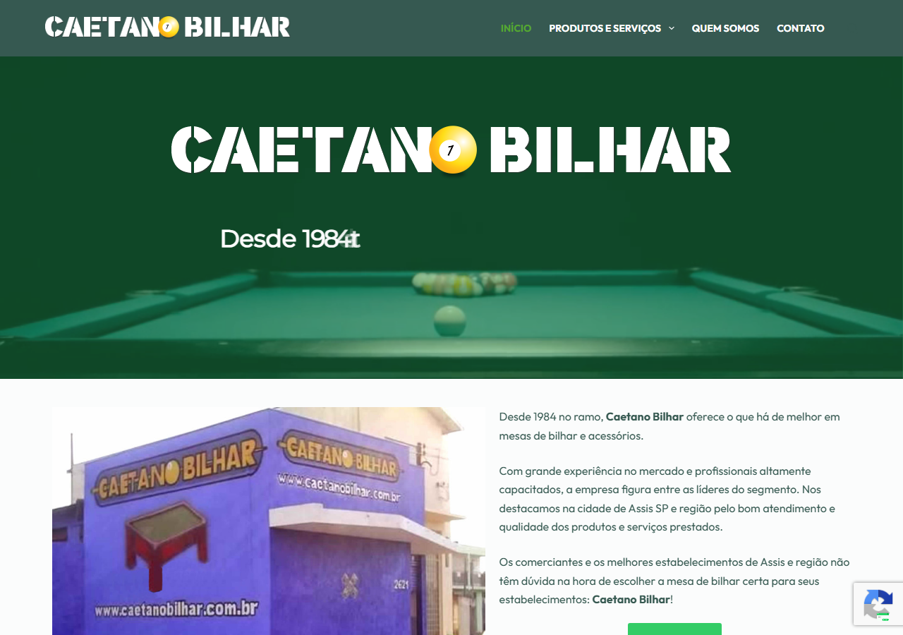](https://www.caetanobilhar.com.br/) | **[Caetano Bilhar](https://www.caetanobilhar.com.br/)** *Stack: WordPress · WooCommerce · Elementor · Contact Form 7 · Smart Slider 3* Venda, locação e reforma de mesas de bilhar em Assis e região. • Vitrine + loja online (WooCommerce) • Formulário de contato (CF7) • SEO local |
| [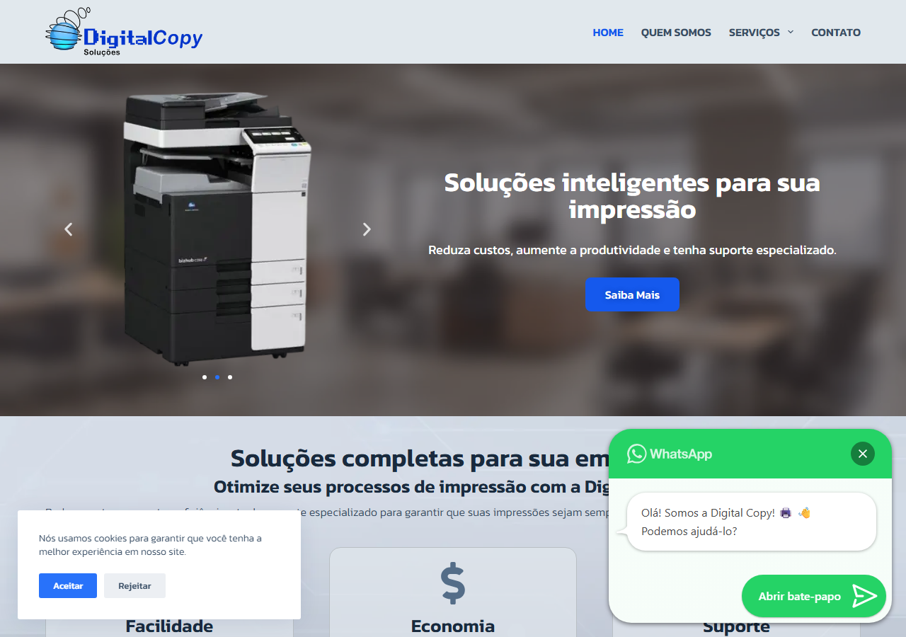](http://www.digitalcopysolucoes.com/) | **[Digital Copy Soluções](http://www.digitalcopysolucoes.com/)** *Stack: WordPress · Elementor · Blocksy Pro* Locação de impressoras em Maringá. • Planos e benefícios de redução de custos • Formulário de orçamento + WhatsApp |
|  | **[Gobbi & Lanziotti](https://www.gobbilanziotti.com.br/)** *Stack: WordPress · Elementor · Contact Form 7 · OceanWP* Empresa de cobranças com soluções jurídicas. • Departamento jurídico, cobrança extrajudicial e judicial • Formulários (CF7) e atendimento via WhatsApp • Carteira de clientes |
| [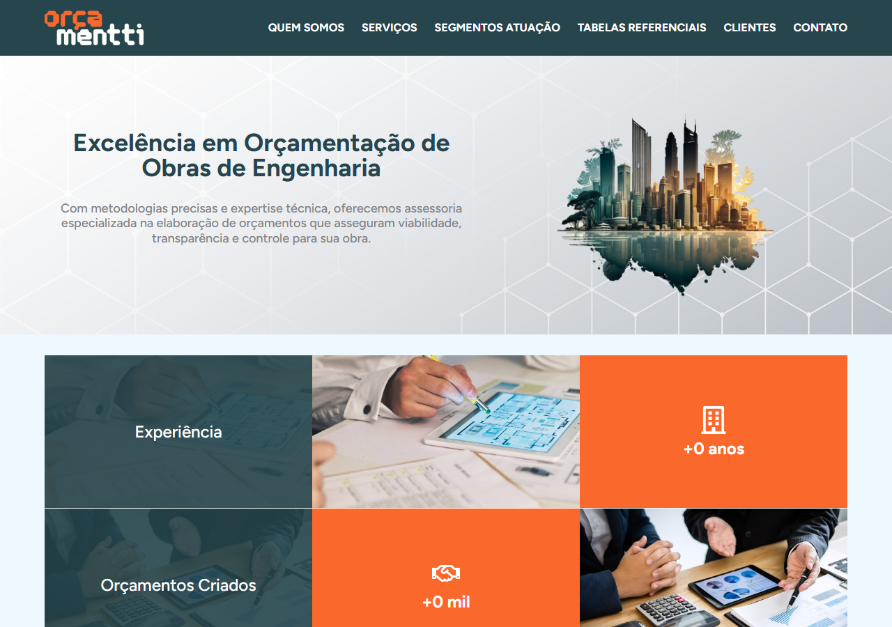](https://www.orcamentti.com/) | **[Orçamentti](https://www.orcamentti.com/)** *Stack: WordPress · Blocksy Pro · LiteSpeed Cache* Orçamentação de obras de engenharia. • Serviços, segmentos de atuação e tabelas referenciais • Carteira de clientes |
|  | **[Egecon Garantidora](https://www.egecongarantidora.com)** *Stack: WordPress · Elementor* Garantidora condominial em Maringá-PR. • Soluções de gestão, cobrança de taxas e inadimplência • 2ª via de boleto, vídeo institucional e FAQ • Atendimento via WhatsApp |

### 📰 Portais & Mídia

| Screenshot | Projeto & Detalhes Técnicos |
|:---:|:---|
|  | **[Maringá Manchete](https://www.maringamanchete.com.br/)** *Stack: WordPress · SliderPack* Portal de notícias de Maringá e região. • Estrutura editorial com categorias e redação diária • Sliders de notícias em destaque • SEO on-page e performance para alto volume de conteúdo |

---

## 📬 Contato

Gostou do meu trabalho ou possui um desafio de desenvolvimento? Vamos conversar!

- 🌐 [ViaWeb (Meu Site)](https://www.viaweb.pro/)
- 💼 [LinkedIn](https://www.linkedin.com/in/rodrigocaetanooficial/)
- 🐙 [GitHub](https://github.com/rodrigocaetanooficial)
- ✉️ [inexistent.man@gmail.com](mailto:inexistent.man@gmail.com)
- 📱 WhatsApp: [**(44) 99898-2168**](https://wa.me/5544998982168)

 

⭐️ Se você gostou deste repositório, não esqueça de deixar uma estrela!

